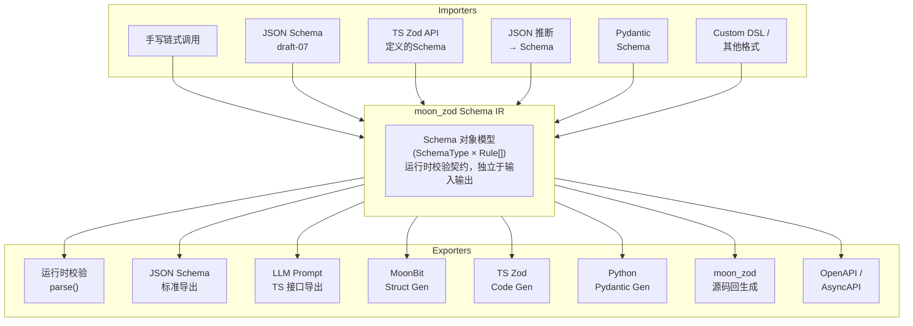
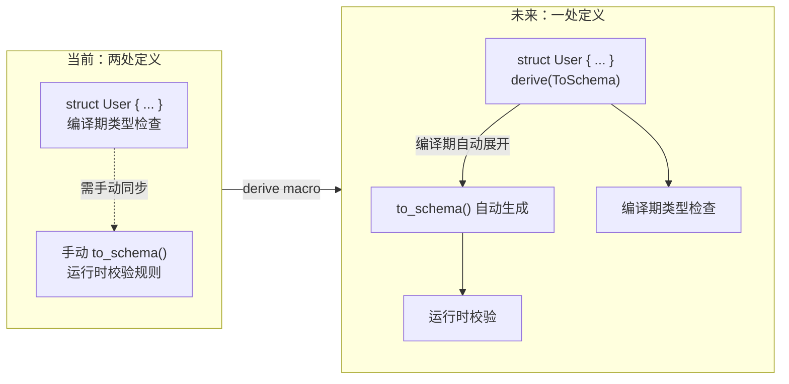

# 设计文档

## 定位：Schema IR

moon_zod 的核心定位是 **运行时 Schema 中间表示（IR）**——一个独立于输入来源和输出目标的校验契约层。它不像传统校验库那样绑定到特定的数据格式定义方式，而是在前端导入与后端导出之间建立了一个统一的 Schema 对象模型。



## 核心价值：解耦

- **输入无关**：无论 Schema 来源于手写代码、JSON 推断、标准 JSON Schema 还是未来的派生宏，最终都归约为统一的 `Schema` 对象
- **输出可扩展**：同一个 Schema 对象可以导出为 JSON Schema、LLM Prompt、MoonBit 结构体或 moon_zod 源码，新增导出器无需修改校验逻辑
- **作为契约桥梁**：只需要定义某种格式到 Schema 的导入器，就能自然地借助 moon_zod 的导出器将其转换为其他各种格式，形成一个**跨语言、跨生态的 Schema 互操作桥梁**

## 目标定位

| 维度 | 定位 |
|------|------|
| **生态角色** | MoonBit 生态中的**基础校验设施**，对标 TypeScript 生态的 Zod / Python 生态的 Pydantic |
| **核心场景** | **LLM Tool Calling** 的结构化输出校验，兼顾通用 JSON 校验 |
| **能力边界** | 运行时动态校验（parse）、多格式导出（Export）、多源导入（Import）、代码生成（Code Gen） |
| **非目标** | 不取代 MoonBit 编译期类型系统；核心包不承担异步运行时；不做 ORM / 序列化框架 |

---

## 当前架构概览

### 可选异步扩展

`Betterlol/moon_zod/async` 是独立的可选子包，核心 `Schema::parse()`
保持同步。扩展提供以下能力：

- `AsyncSchema`：先完成同步规则、转换和 Strip 清洗，再按声明顺序执行
  `refine_async()`（单问题）和 `super_refine_async()`（多问题）。普通失败
  返回 `AsyncParseResult`：`Validation` 携带校验问题，`Execution` 保留
  原始执行错误、回调索引及已收集的校验问题；任务取消继续传播。
- `validate_jsonl()`：增量读取 JSON Lines；异步版本逐条执行 refine。
- `read_sse()` / `validate_sse_json()`：解析 SSE 帧或逐帧校验 JSON。
- `validate_sse_json_stream()`：跨 SSE 帧拼接一个原始 JSON 文档，在
  DONE/EOF 时确认结果；异步版本在同步解析成功后执行 refine，转换和
  同步规则只运行一次。执行失败单独计入 `execution_failed`。

同步与异步适配器共享读取和事件分发流程。回调顺序等待，预取量有界；
reader 的关闭及超时由调用者负责。行/帧按 UTF-8 字节设限，跨帧文档
另有 UTF-16 长度和嵌套深度限制。逐块字节视图减少行读取的中间复制。

`AsyncSchema` 通过工厂和链式方法创建，内部状态私有。异步检查作用于
整个清洗后的值，可用相对路径报告字段问题。字段级异步 Schema 组合、
异步转换和自动并发需要另行设计输出 Schema、效果顺序与取消语义，
当前保留顺序执行的行为。核心校验继续无需依赖异步运行时。


### 1. 统一解析协议与路径栈

公共 `parse()` / `safe_parse()` 复制输入后进入私有解析器。内部 `ParseOutput`
同时保留已解析值、缺失状态、错误列表与不可继续标记。每个节点先解析结构，
再运行自己的规则；类型错误阻止父级回调，普通约束错误允许继续收集错误。
公开 parse helper 保留签名并转发到同一解析协议。

对象、数组和 tuple 重建容器，所有对象模式都返回子节点转换后的值。
union 和 intersection 的各分支使用独立输入，intersection 递归合并对象和
数组，冲突返回结构化错误。此协议会分配容器和错误数组，不能宣称成功路径零分配。

路径栈进入子节点时 push，返回时 pop。特殊字段名用带引号的括号表示，
`ValidationError.path_segments` 提供不混淆字段与索引的结构化路径。

### 2. 规则所属层与结构化元数据

泛型 `refine()` 附加在当前层，内建类型规则可穿透 optional、nullable、
default、prefault 及 pipe 的输出层；`message()` 只修改最近规则的消息。
`Rule` 保存 `Constraint` 与显式消息来源，`TransformClosure` 保存 `TransformKind`。
源码导出使用这些元数据还原方法，遇到自定义闭包返回明确的不支持错误。

### 3. 缺失与 null

缺失输入通过私有协议处理，不把 null 作为缺失哨兵交给 JSON 回调。
optional 允许缺失，nullable 允许显式 null，nullish 同时允许两者。
default 填充输出值并跳过内层解析；prefault 把默认值作为输入继续校验和转换。
包含默认值的缺失对象字段会出现在解析结果中。

### 4. Schema 图与组合器

工厂与修改器分配节点标识，构造器复制传入的可变集合。统一子节点遍历包含
所有容器、wrapper、pipeline 与 lazy，lazy 解析缓存一次。命名导出可使用递归
引用；名称冲突和不支持的匿名递归返回清楚的错误。

pick、omit、partial、extend_with 和 merge 保留对象模式，但拒绝更改已附加
refine 的对象形状，避免回调继续依赖被删除或改变的字段。应先组合形状再 refine。

### 5. 导出阶段的契约

旧 `to_json_schema()` 是面向生成任务的闭合结构契约。
`try_to_json_schema(view=InputView/OutputView)` 明确区分原始输入与解析结果：
输入 Strip 对象允许额外字段，输出 Strip 对象不含额外字段。无法表示的阶段
返回 `Err`，不能把未知自定义转换当作恒等函数。详细边界见
[迁移说明](CHANGELOG.md#core-migration)。

---

## 未来方向：派生宏（Derive Macro）

当前 moon_zod 要求用户通过链式 API 手写 Schema 定义。这在动态性上提供了最大灵活度，但也意味着需要维护两份定义——MoonBit 结构体类型 + 对应的 runtime Schema。

库中已有的 `schema_to_moonbit_struct_full()` 可以从 Schema 反向生成结构体定义和静态 `Type::to_schema()` 方法，但方向是从 Schema 到结构体。未来期许是通过 MoonBit 的 derive 宏机制，**从结构体定义直接派生 Schema**，实现"一处定义，两处使用"——这是对现有 `to_schema()` 模式的编译期派生升级。

### 预期书写方式

```mbt
///|
/// 定义结构体，同时通过 derive(ToSchema) 自动生成
/// 对应的 moon_zod schema，连接静态类型与运行时校验。
/// 注意：本语法为预期设计，不代表最终语法支持。
/// 待 MoonBit 正式支持 derive macro 后重新设计实现。
struct User {
    #[zod(min = 1)]
    #[zod(pattern = "^[a-zA-Z0-9_]+$")]
    id: String

    #[zod(min = 3)]
    #[zod(max = 20)]
    name: String
} derive(ToSchema)
```

### 期望展开结果

```mbt
///|
/// compile 期自动展开，等效于手写：
pub fn User::to_schema() -> @moon_zod.Schema {
    @moon_zod.object({
        "id": @moon_zod.string().min(1).pattern("^[a-zA-Z0-9_]+$"),
        "name": @moon_zod.string().min(3).max(20),
    })
}
```

### 价值



> **前置条件**：derive macro 依赖 MoonBit 编译器对宏机制的支持。待 MoonBit 正式提供 derive macro 能力后即可实现，当前以链式 API 手写和反向代码生成为主。

这将是 moon_zod 从"好用的校验库"进化为 **MoonBit 生态的 Schema 基础设施**的关键一步——用户只需关心结构体定义和约束注解，Schema 的生成、校验、导出全部自动完成。

---

## 参考

- [Zod](https://zod.dev/) — TypeScript 版参考 API
- [Pydantic](https://docs.pydantic.dev/) — Python 版参考
- MoonBit core `@json` 包 — 了解当前 JSON 类型系统
